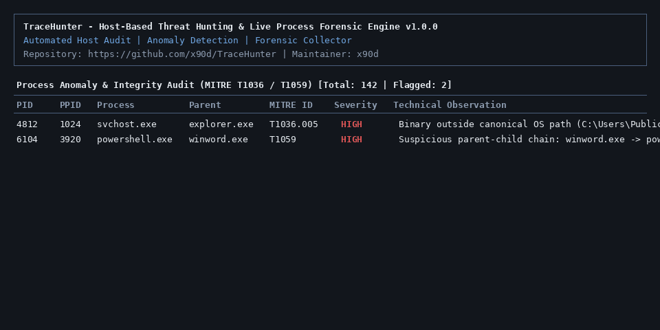

# TraceHunter: Host-Based Threat Hunting & Live Memory/Process Forensic Engine

[](https://github.com/x90d/TraceHunter)
[](https://github.com/x90d/TraceHunter)
[](https://github.com/x90d/TraceHunter)
[](https://github.com/x90d/TraceHunter/blob/main/LICENSE)
[](https://github.com/x90d/TraceHunter)

**Standalone Python host inspection utility for live process anomaly detection, persistence mechanism auditing, active network socket correlation, and local YARA triage mapped to MITRE ATT&CK.**

<p align="center"></p>

---

## Table of Contents

1. [Problem Statement](#problem-statement)
2. [MITRE ATT&CK Mapping Table](#mitre-attck-mapping-table)
3. [Architecture Overview](#architecture-overview)
4. [Quickstart Guide](#quickstart-guide)
5. [Command-Line Reference](#command-line-reference)
6. [STIX 2.1 Output Format](#stix-21-output-format)
7. [Ethical Scope & Disclaimer](#ethical-scope--disclaimer)
8. [License](#license)

---

## Problem Statement

During incident response triage and baseline host threat hunting, analysts frequently need to verify whether running processes correspond to legitimate system binaries, check whether unauthorized persistence entries have been registered, correlate active network sockets to specific Process IDs (PIDs), and inspect temporary staging directories against known indicator patterns without deploying heavy agent infrastructure.

**TraceHunter** provides a self-contained, read-only forensic collector and anomaly detection engine designed for rapid host inspection. It aggregates process tree metadata, SHA-256 binary digests, autorun persistence artifacts, socket states, and local YARA matches into structured terminal tables (`rich`), machine-readable JSON reports, or OASIS STIX 2.1 bundles suitable for SIEM ingestion.

---

## MITRE ATT&CK Mapping Table

| Module | Detection Focus | MITRE ATT&CK ID | Technique Name | Tactic |
| :--- | :--- | :--- | :--- | :--- |
| `core/process_engine.py` | System binary executing outside canonical OS directory (`svchost.exe`, `explorer.exe`, `lsass.exe`, etc.) | [T1036.005](https://attack.mitre.org/techniques/T1036/005/) | Masquerading: Match Legitimate Name or Location | Defense Evasion |
| `core/process_engine.py` | Binary executing directly from `%TEMP%`, `\Users\Public\`, or user-writable staging paths | [T1036](https://attack.mitre.org/techniques/T1036/) | Masquerading | Defense Evasion |
| `core/process_engine.py` | Suspicious parent-child execution chains (e.g., `winword.exe`, `excel.exe`, or browser spawning `cmd.exe` / `powershell.exe`) | [T1059](https://attack.mitre.org/techniques/T1059/) | Command and Scripting Interpreter | Execution |
| `core/persistence_engine.py` | Windows Registry `Run` / `RunOnce` keys (`HKCU` & `HKLM`) and user/system Startup folder items | [T1547.001](https://attack.mitre.org/techniques/T1547/001/) | Boot or Logon Autostart Execution: Registry Run Keys / Startup Folder | Persistence |
| `core/persistence_engine.py` | Scheduled Tasks executing binaries or scripts outside standard system directories | [T1053.005](https://attack.mitre.org/techniques/T1053/005/) | Scheduled Task/Job: Scheduled Task | Persistence |
| `core/persistence_engine.py` | Windows Service configurations with unquoted binary paths containing spaces | [T1574.009](https://attack.mitre.org/techniques/T1574/009/) | Hijack Execution Flow: Path Interception by Unquoted Path | Persistence / Privilege Escalation |
| `core/network_correlator.py` | Active TCP/UDP socket correlation to PID/executable and non-RFC1918 public IP identification | [T1049](https://attack.mitre.org/techniques/T1049/) | System Network Connections Discovery | Discovery |
| `core/yara_scanner.py` | Local YARA inspection of `%TEMP%` and `Downloads` for web shells, reverse shells, and script droppers | [T1505.003](https://attack.mitre.org/techniques/T1505/003/) / [T1027](https://attack.mitre.org/techniques/T1027/) | Server Software Component: Web Shell / Obfuscated Files or Information | Persistence / Defense Evasion |

---

## Architecture Overview

```text
TraceHunter/
├── tracehunter.py              # Main CLI entry point (argparse, i18n, Rich table renderer)
├── core/
│   ├── __init__.py             # Package metadata and version definition
│   ├── i18n.py                 # Bilingual localization dictionary (English & Bahasa Indonesia)
│   ├── process_engine.py       # Process tree auditor, masquerading detector, SHA-256 hasher
│   ├── persistence_engine.py   # Registry Run/RunOnce, Startup dirs, Tasks, Unquoted Service Paths
│   ├── network_correlator.py   # Active TCP/UDP socket-to-PID mapper & non-RFC1918 classifier
│   ├── yara_scanner.py         # Local YARA signature compiler and directory triage scanner
│   └── forensic_exporter.py    # Structured JSON and OASIS STIX 2.1 bundle serializer
├── rules/
│   ├── webshell_indicators.yar     # PHP, JSP, and ASPX web shell patterns
│   ├── reverseshell_indicators.yar # PowerShell, Bash, Python, and Netcat reverse shell patterns
│   └── script_dropper.yar          # PowerShell/LOLBin download-and-execute dropper rules
├── assets/
│   └── demo.gif                # Terminal execution preview
├── requirements.txt            # Minimal runtime dependencies (rich, psutil, yara-python, cryptography)
├── run.bat                     # Windows automated environment bootstrapper and launcher
├── run.sh                      # POSIX/Linux automated environment bootstrapper and launcher
├── LICENSE                     # MIT License
└── README.md                   # Technical documentation
```

---

## Quickstart Guide

### Option 1: Automated One-Click Execution (Windows)

Run `run.bat` from an Administrator command prompt or Windows Explorer. The bootstrapper verifies Python 3.9+, initializes `.venv`, installs required packages once (tracked via `.venv\installed_marker.txt`), and executes `--scan-all`:

```bat
run.bat
```

### Option 2: Automated Execution (Linux / macOS)

```bash
chmod +x run.sh
./run.sh
```

### Option 3: Manual Virtual Environment Setup

```bash
git clone https://github.com/x90d/TraceHunter.git
cd TraceHunter
python -m venv .venv

# Windows activation:
.venv\Scripts\activate
# Linux/macOS activation:
source .venv/bin/activate

pip install -r requirements.txt
python tracehunter.py --scan-all
```

---

## Command-Line Reference

```text
usage: tracehunter.py [-h] [--scan-all] [--hunt-processes] [--hunt-persistence]
                      [--audit-network] [--yara DIR]
                      [--output-format {table,json,stix}] [--output-file FILE]
                      [--lang {en,id}]
```

| Argument | Description |
| :--- | :--- |
| `--scan-all` | Execute all host inspection engines (processes, persistence, network, and default YARA scan). |
| `--hunt-processes` | Audit running processes for masquerading (`T1036`), parent-child anomalies (`T1059`), and binary SHA-256 hashes. |
| `--hunt-persistence` | Inspect Windows Registry `Run`/`RunOnce` keys, Startup folders, Scheduled Tasks, and Unquoted Service Paths. |
| `--audit-network` | Map active TCP/UDP sockets to PIDs and flag connections to public non-RFC1918 IPv4/IPv6 addresses. |
| `--yara <dir>` | Scan a specific directory (or pass `""` to scan default `%TEMP%` and `Downloads` folders) against `rules/*.yar`. |
| `--output-format [table\|json\|stix]` | Render output as structured console tables (`table`), structured JSON (`json`), or OASIS STIX 2.1 (`stix`). |
| `--output-file <path>` | Write exported JSON or STIX 2.1 report to a custom file path. |
| `--lang [en\|id]` | Select CLI output and table header language: `en` (English, default) or `id` (Bahasa Indonesia). |

### Example invocations

```bash
# Run full host audit with English tabular output
python tracehunter.py --scan-all --lang en

# Run full host audit in Bahasa Indonesia
python tracehunter.py --scan-all --lang id

# Inspect only process tree and active network connections
python tracehunter.py --hunt-processes --audit-network

# Scan a custom staging directory with YARA rules and export findings to STIX 2.1
python tracehunter.py --yara "C:\Users\Public\Downloads" --output-format stix --output-file stix_report.json
```

---

## STIX 2.1 Output Format

When invoked with `--output-format stix`, `core/forensic_exporter.py` generates a standards-compliant OASIS STIX 2.1 `bundle` containing:

- **`identity`**: Identifies the `TraceHunter Collector` instance and host operating system metadata.
- **`attack-pattern`**: Normalized MITRE ATT&CK technique objects with external references (`T1036.005`, `T1059`, `T1547.001`, `T1053.005`, `T1574.009`, `T1049`, `T1505.003`).
- **`indicator`**: CybOX/STIX patterns representing anomalous processes (`[process:name = '...' AND file:hashes.'SHA-256' = '...']`), persistence commands, external network sockets (`[network-traffic:dst_ref.value = '...']`), and YARA file matches.
- **`relationship`**: Links each `indicator` to its corresponding `attack-pattern` via `indicates`.

Example STIX 2.1 output excerpt:

```json
{
  "type": "bundle",
  "id": "bundle--c8a4f2d1-9c12-4d3e-8b1a-7f2e5d4c3b2a",
  "objects": [
    {
      "type": "identity",
      "spec_version": "2.1",
      "id": "identity--5e9d2b14-8a4c-5f32-9b11-2c4e6f8a0b12",
      "created": "2026-11-08T04:00:00Z",
      "modified": "2026-11-08T04:00:00Z",
      "name": "TraceHunter Collector (WORKSTATION-01)",
      "identity_class": "system"
    }
  ]
}
```

---

## Ethical Scope & Disclaimer

TraceHunter is a defensive host auditing and forensic triage instrument intended strictly for authorized system administrators, security operations analysts, and digital forensic investigators inspecting systems they own or have explicit written permission to audit.

The software operates in a read-only inspection mode and does not terminate processes, modify registry keys, or alter network firewall states. The author (`x90d`) assumes no liability for misuse or operational misinterpretation of generated audit reports.

---

## License

Distributed under the **MIT License**. See [`LICENSE`](LICENSE) for full license text.

Copyright (c) 2026 [x90d](https://github.com/x90d/TraceHunter).
